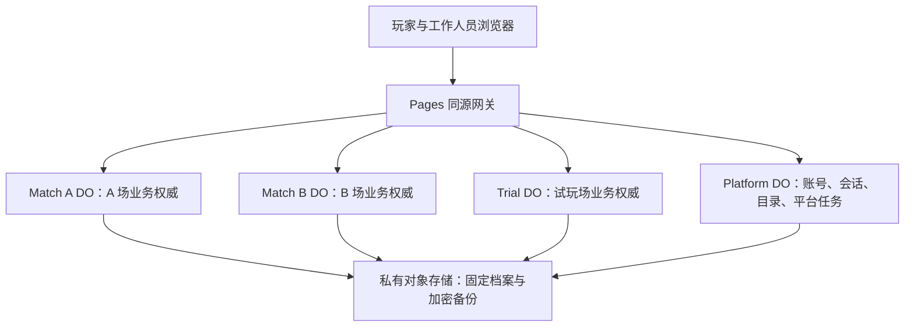

# 跨比赛账号与数据管理方案

编写日期：2026-11-05。本文保留原始设计。实际交付以[实现说明](跨比赛账号与数据管理实现说明_2026-11-05.md#验证与交付边界)为准；用户已取消其中列出的七项能力或验收工作，本文相应设计及验收条目不再作为交付条件。日常操作见[办赛快速上手](办赛快速上手.md)。

本文解决连续举办比赛、网站内创建试玩、查询历史比赛、更换裁判、管理预注册账号及数据生命周期的问题。日常事务在网站完成；仅基础设施变更、跨部署迁移和复杂灾难恢复进入本地 TUI Wizard。文中的页面、接口、表和命令均为拟建设内容，现状证据另列于第 2 节。

## 1. 依据与核心决定

### 1.1 选择性阅读范围

本次通过[项目概览](ai/项目概览.md)和[文档导航](ai/文档导航.md)定位，核对了以下相关原文和补充，没有默认通读两份核心文档。

| 来源                                                                                                     | 本次使用的范围                                                                                                                              |
| -------------------------------------------------------------------------------------------------------- | ------------------------------------------------------------------------------------------------------------------------------------------- |
| [完整策划案](黑暗森林_完整策划案.md)                                                                     | §3 身份、昵称与母星；§10.1—10.2 裁判岗位；§14.5 试玩观察；§15.1—15.2 系统与现场职责                                                         |
| [技术方案](黑暗森林_技术方案.md)                                                                         | §2.1—2.3 多场对象与部署；§3 身份；§4.1—4.2、§4.4 数据边界；§8.3 名单与开赛；§15.1 登录；§16.7—16.9 恢复；§17 隐私与保留；§19 部署和现场运行 |
| [赛前参数与正式名单补充](赛前参数与正式名单补充_2026-11-04.md)                                           | 候选账号池和正式名单的区别、人数来源、T0 冻结、昵称规范                                                                                     |
| [网站前端页面与功能规划](网站前端页面与功能规划.md)                                                      | §1.2 信息边界、赛后完整复盘；§2.1 不开放公共注册和匿名观战                                                                                  |
| [裁判员指令系统完整规划](裁判员指令系统完整规划.md)                                                      | §2 保留流程和排除项；§5.11 账号与恢复；§6.1—6.3 定时授权和历史                                                                              |
| [后端接口与运行说明](后端接口与运行说明.md)                                                              | 当前初始化、口令、维护、导出与恢复；其中旧 Schema 记录不作为最新版本结论                                                                    |
| [指令系统实现与验收](裁判员指令系统实现与验收_2026-11-05.md)、[审计修复说明](审计修复说明_2026-11-05.md) | 单场服务、持久任务、恢复保全及 Schema 7 的文档记录；不把已有测试结果当成本方案的验收                                                        |

### 1.2 本次授权和设计补充

用户要求规划跨比赛管理并明确网站优先。下表是实现目标所需的设计变化，不表示用户已逐项确认实现细节；本次只形成方案，不修改核心原文或运行系统。

| 现有约定或边界                                             | 本方案补充                                                               |
| ---------------------------------------------------------- | ------------------------------------------------------------------------ |
| 账号、口令和会话直接属于一场比赛                           | 增加长期账号、平台会话；单场文明与裁判任职继续属于比赛                   |
| 当前代码通过固定 `MATCH_ID` 路由                           | 按已登记且已授权的场次路由至独立 DO；每场唯一对象，不改成每场一个 Worker |
| 总裁判账号由部署管理员管理，旧指令规划不建设创建与晋升系统 | 新增网站平台管理和总裁判交接，独立于赛事指令，不把部署凭据交给裁判       |
| 完整复盘与归档后隐私清理并存，未明确跨场访问期限           | 分为完整复盘期、裁剪档案、受限审计期；到期范围和后果提前告知             |
| PITR 依靠手动 CLI 流程                                     | 网站负责检查点、状态和业务核对；复杂恢复执行用中文 TUI 引导              |

继续遵守既有玩法：正式名单与八项参数在首次锁定 T0 后冻结，撤销未来 T0 不解除冻结；T1 前允许的缺席移除沿用现有流程。阶段边界、双时基、手环码场内永久不复用、98 分钟核验、完赛后战报版本更正不变。

不借平台管理增加开放注册、地图、照片上传、QQ 自动发送、离线比赛补录、已开赛比赛的强制结束/作废或完赛后重开。试玩也不借“重置”暗中实现这些能力。

### 1.3 核心决定

1. 一个站点管理多场比赛，固定部署承载多个独立对象。网站创建第二场只是新增数据与 DO，无需重新部署。
2. 长期账号与单场身份分开。同一玩家在 A 场可为 C07、B 场为 C03；工作人员使用独立账号，J01 等仅代表本场岗位。
3. 平台负责账号认证、赛事目录与平台管理；各场 DO 负责本场身份授权、名单和全部比赛事实。列表与统计只能是可重建投影。
4. 试玩使用真实后端、独立对象及随机材料，与 UI 模拟预览区分。重新试玩必须新建场次。
5. 历史比赛有永久地址和独立权限，不受“当前推荐比赛”改变影响；战报按版本保存。
6. 跨对象操作有可恢复任务和逐目标收据，部分完成不能显示成全部成功。

## 2. 当前实现与缺口

下列结论来自本次工作区代码定位和文件检查，不代表线上部署已验证。

| 证据                                                                                                  | 已有能力                                                         | 跨比赛缺口                                               |
| ----------------------------------------------------------------------------------------------------- | ---------------------------------------------------------------- | -------------------------------------------------------- |
| `apps/web/functions/_lib/gateway.ts`：`GatewayEnv`、`gateway()`                                       | Origin、正文和 Cookie 校验；固定调用 `match:${env.MATCH_ID}`     | 缺少目录、跨场身份和按场授权路由，改环境变量不是网站管理 |
| `apps/match-worker/src/rpc/types.ts`：`BackendEnv`；两个应用的 `wrangler.jsonc`                       | local/preview 分别配置固定 `MATCH_ID` 与绑定                     | 运行时场次身份要从共享环境移到对象不可变元数据           |
| `apps/match-worker/src/services/engine.ts`：`bootstrap()`                                             | 初始化本场账号，要求 2—350 名玩家及 3 名独立裁判                 | 需支持空草稿、日常增建账号和网站创建场次                 |
| `apps/match-worker/src/storage/store.ts`：`Actor`、`Store.match()`                                    | 单对象保存一场；账号含场次、角色、权限、凭据摘要                 | 无长期账号主键，C01 不能成为某个人的全局 ID              |
| `apps/match-worker/src/services/accounts.ts`：`accountList()`、`validateAccount()`、`updateAccount()` | 本场普通账号停用、启用、重置和职责调整；撤销旧会话，保护系统账号 | 缺少账号池、总裁判换人、跨场任职和个人履历               |
| `apps/match-worker/src/index.ts`：`DarkForestMatch`                                                   | `call/bootstrap/alarm/recovery` 集中在本场                       | 需增加平台对象、受信创建通道和多场隔离契约               |
| 后端运行说明及指令实现记录                                                                            | 本场战报、审计、备份、检查点与恢复流程                           | 不等于跨场档案中心；普通导出入口不等于固定时点的归档文件 |

已有单场账号维护应复用，不应笼统认定为“完全没有账号管理”。本次补齐的是跨比赛组织与生命周期；不重写赛事结算，不修改当前业务代码。

## 3. 网站与本地功能分工

### 3.1 网站必须建设

| 任务                 | 网站操作和结果                                                |
| -------------------- | ------------------------------------------------------------- |
| 举办第二场           | 新建或复制设置，分配新 ID 和独立 DO，旧比赛保留，无需部署     |
| 办试玩、再次试玩     | 选择试玩类型或“以此设置再建一场”，独立数据，始终带试玩标识    |
| 比赛切换             | 我的比赛、管理比赛、永久链接；只改变当前标签页                |
| 预注册账号           | 创建、批量导入、分组、邀请、停用、重发、疑似重复核验          |
| 候选与正式名单       | 从池中加入本场候选，再由总裁判确认正式名单；本场执行冻结门禁  |
| 换普通裁判、换总裁判 | 邀请、接受、交接预览和原子切换，保留实际人员履历              |
| 凭证和会话           | 重置、找回审批、撤销设备、全局停用，显示影响的比赛            |
| 历史数据             | 按日期、类型、本人身份和状态查询，读取固定版本战报及有权复盘  |
| 导出与归档           | 选择用途、字段、格式，后台生成固定产物，受权下载与完整性检查  |
| 保留与清理           | 期限设置、申诉保留、清理预览、延后、确认及结果核验            |
| 日常备份             | 创建检查点、生成加密包、下载与副本校验，不要求手写 CLI        |
| 日常诊断             | 健康面板、任务重试、投影重建、既有调度修复，不提供 SQL 编辑器 |
| 历史导入             | 上传本站已定义格式的签名归档包，验证后导入为隔离只读档案      |
| 平台设置             | 模板、推荐比赛、管理员和所有权交接，不修改已冻结单场参数      |

### 3.2 允许使用本地 TUI 的例外

| 功能                                 | 留在本地的理由                                       | 网站仍承担的部分                         |
| ------------------------------------ | ---------------------------------------------------- | ---------------------------------------- |
| 首次安装、域名/绑定、程序发布与回滚  | 网站尚不存在，或需要基础设施凭据与部署操作           | 显示环境、版本和升级检查结论             |
| 新增/更换 Worker 池、跨云账号迁移    | 动态管理部署、命名空间、密钥和路由                   | 申请、查看状态，迁移后日常使用           |
| PITR、备份灾难恢复                   | 跨回滚保全码本、通知、身份和任务，且网站可能不可访问 | 检查点、下载材料、状态和恢复后的业务核对 |
| 全部平台所有者失联或丢失凭证         | 网站认证途径已不可用，需要独立根恢复凭据             | 仍有所有者时，在网站完成普通交接和重置   |
| 根密钥轮换、旧部署接入、未知版本修复 | 涉及 Secrets、兼容转换和跨库核验，失败影响面大       | 版本与检查结果，绝不展示根密钥           |

文件大、耗时长、批量操作或需要删除确认，不足以成为移到本地的理由。网站用后台任务、分页和分块上传完成。已知格式的归档导入不能一律丢给 TUI；任意第三方数据库转换则不属于日常导入。

## 4. 架构与权威边界

### 4.1 固定部署承载多场

第一版沿现有技术栈：一个 Pages 站点，同一个后端 Worker 导出 `DarkForestPlatform` 和 `DarkForestMatch` 两个 SQLite-backed DO 类；私有对象存储保存归档、导出和备份。生产与开发/预览使用不同绑定、存储和密钥。



目录保存 `pool_id + object_name`，`pool_id` 只能映射到已部署的可信绑定。网站不能提交任意 Worker 名或 URL。正常新建始终选默认池，同一 Worker 中不同 DO 就是不同比赛，不需要动态部署 Worker。

一个 Worker 的代码升级影响其中全部比赛，因此发布前列出所有受影响场次；有正在进行的正式比赛时默认不发布，遵守原有禁止未演练发布的要求。需要并行保留不同运行版本、额外隔离试玩或容量时，才由 TUI 增设固定池。`ruleset_version` 仅表示规则配置，不能伪装成引擎二进制版本固定。

### 4.2 各数据的唯一归属

| 位置         | 权威内容                                                                        | 不承担的职责                                   |
| ------------ | ------------------------------------------------------------------------------- | ---------------------------------------------- |
| Platform DO  | 长期账号、凭据摘要、平台会话/角色、邀请、赛事目录、模板、平台操作审计和清理账本 | 不保存第二份可编辑的比分、航次、母星或正式名单 |
| Match DO     | 本场身份绑定、任职权限、候选/正式名单、规则快照、战局、通知、定时任务、战报版本 | 不让目录写操作绕过冻结、阶段与业务事务         |
| 私有对象存储 | 不可变归档文件、导出、加密备份、清单及摘要                                      | 不作为活动比赛的可变数据库，不公开桶           |
| 平台查询投影 | 比赛状态摘要、参赛索引、成绩摘要及来源版本                                      | 不作为最终授权，不以过期状态决定可删除或已完赛 |

目录决定“比赛在哪里”，本场 DO 决定“比赛现在如何”。列表显示最后同步时间，危险操作读本场当前状态。第一版不引入 D1、搜索集群或动态 Worker 编排；平台 DO 的吞吐和容量需按多场同时在线人数实测，现有单场测试不构成容量证明。

### 4.3 场次标识、路由和密钥

- `match_id` 是不可变随机 ID；名称、显示编号与短链接别名分开。改名保留旧别名跳转，删除后的 ID 不重用。
- 保留现有 `match:<match_id>` 对象命名，环境由命名空间隔离；改变旧对象名称会得到空对象，迁移时不能随意重命名。
- 首次初始化写入 ID、类型、创建操作 ID、规则和密钥版本；后续请求场次必须匹配对象元数据。
- 从业务代码移除共享 `env.MATCH_ID`，特别检查 HMAC、AES AAD、日志、恢复、初始化和通知。新场密钥按环境/场次/用途/版本从服务端根密钥派生，或独立生成后加密保存；旧密文仍按原版本读取。
- 网关先查已登记路由并鉴权，再调用目标对象；不存在或无权访问的随机 ID 不能触发任意对象创建。公开简介只返回已明确发布的安全元数据。
- 所有业务请求使用显式 `/api/matches/:matchId/...`。首页推荐比赛只负责入口，服务器不得把错误场次静默改成默认场次。

## 5. 长期账号、预注册与登录

### 5.1 身份模型

| 概念                                      | 示例                                 | 规则                                               |
| ----------------------------------------- | ------------------------------------ | -------------------------------------------------- |
| 长期账号 `account_id`                     | 随机 ID，显示名称/受限联系备注       | 跨场存在；显示名称变更不改历史快照                 |
| 账号类别                                  | 玩家、工作人员                       | 凭据与会话分离；工作人员账号本身不等于任何场的裁判 |
| 本场文明 `participant_id/civilization_id` | M1 的 C07                            | 同场唯一，昵称本场锁定，下场可重新确认昵称         |
| 裁判席位 `seat_id`                        | M1 的 J01 总裁判、J02 通讯、J03 事件 | 岗位延续，个人通过任职加入                         |
| 任职 `assignment_id`                      | 某工作人员在某时接任 J01             | 保存起止及权限版本，不把旧席位日志改成新人所为     |
| 历史访问关系                              | 某账号正式参加过 M1                  | 依据当时正式参与事实，不能依赖当前存活或候选状态   |

工作人员用独立于玩家的账号；可受限关联同一自然人的两类账号以排查冲突，不建设额外实名库。禁止同一自然人在同场同时参赛和执裁，另一场参赛可用玩家账号。不能声称系统仅靠姓名就能完全识别所有重复自然人，需要人工核验。

旧 C01/J01 不能直接成为长期账号主键。历史审计补充 `account_id + assignment_id + match_id + 当时显示身份快照`；旧日志无法追溯人员时注明“旧席位账号，实际人员未确认”，不补造来源。

### 5.2 网站预注册账号池

账号池支持查询、标签、创建、CSV 导入、邀请状态、最近登录、停用和参赛记录。QQ 等联系信息仅管理职责可读，非必要不采集；不把姓名、QQ 或昵称当主键。

生命周期为“待领取 → 已激活 → 已停用”，可撤销未领取邀请或受控启用。删除采用关闭/匿名化，不级联删比赛历史。

批量导入先下载模板，再上传预览：新增、明确匹配、疑似重复、格式错误。只有明确 `account_id` 或人工确认映射才更新已有账号，不能同名自动合并。显示行级错误并提供报告下载。第一版对限额内有效行单事务提交，超限分批，每批有独立结果；以批次 ID 和文件摘要防止重复导入。

分组用于班级、候补、工作人员等组织工作，不自动授权。全局池可超过 350 人；单场文明绑定与首航人数仍受 350 容量约束，未绑定文明的邀请不占手环码，不能绕过正式名单上限。

### 5.3 从账号到正式参赛

网站明确显示四层：

```text
平台账号池 → 本场候选/邀请 → 已绑定本场文明 → 正式名单
```

加入候选不等于算人数、领码、算存活或获得赛后完整复盘。用户接受本场邀请、确认活动说明与数据期限后绑定文明，再完成本场昵称、母星和首航准备；总裁判选正式名单，按原条件锁定 T0。

冻结后不得新增或替换正式选手。T1 前允许移除缺席者时保留绑定和退役码；仅曾在草稿名单里的人不因此获得完整复盘。已正式参赛后淘汰、退赛者的历史关系保留，不因其不再存活而抹去。

错误绑定只能在未冻结且不存在需保全的比赛行动前经预览纠正并留痕；冻结后不能把文明转给另一个人冒充账号修复。本人丢口令找回原账号。停用只阻止访问，不自动淘汰、退赛、释放文明编号或改成绩，需要退赛另走赛事业务。

### 5.4 登录、邀请交付与找回

第一版沿用高熵随机口令换取 HttpOnly Cookie，不新增自选弱密码。新账号用短时单次邀请领取，再生成长期凭据；邀请使用后失效。高权限操作要求近期重新认证；生产平台所有者/管理员增加第二因素，采用 TOTP 和一次性恢复码，不依赖 QQ 自动验证码。

长期凭据不放 URL。短时邀请令牌若使用链接，放 fragment，通过 POST 兑换后清除，设置禁缓存和 `no-referrer`，领取页无第三方脚本。交付文字包含网站、账号类别、有效期和场次，提供单人复制/打印卡片，由工作人员人工分发，不自动发 QQ。

凭据仅存安全摘要。交付原文加密短时保存，建议 24 小时删除；邀请默认 7 天有效，可提前撤销。丢失交付内容时重发，不提供永久查看旧口令。幂等重试返回原交付记录，不能不断生成不同凭据。

网站找回由有权管理员核实本人后重置，不把知道 C07 或昵称当身份证明。明确提示全局重置会影响该账号所有比赛。单场总裁判只能重发本场邀请、暂停本场访问或提交找回申请，不能因管理一场就重置长期凭据或查看他场隐私。

玩家与工作人员在同浏览器使用独立 HttpOnly 会话 Cookie，客户端 `audience/role` 只作登录意图，不能授予身份。可延续 12 小时会话上限，提供设备脱敏列表、退出当前设备和全部退出，不返回原始令牌。

### 5.5 多标签页与历史登录

会话代表长期身份，不保存会被全站覆盖的 `current_match_id`。每个标签页的 URL 指定比赛；缓存、查询、待发送操作、预览、幂等和下载任务都包含环境、身份类别、场次及权限版本。

有结果未知的写请求时，先在原比赛查询原 `request_id`，必要时使用既有 resolve 取得确定结论再切场。不能把 A 场待发目击/通知/指令带到 B 场，A 的迟到响应也不能更新 B 的页面。

用户无需旧场专用口令即可访问自己的历史。裁判任期结束默认失去后台和敏感档案权限；复核需要可授予有期限的只读档案权限，不能因“曾执裁”永久拥有后台。

## 6. 平台权限与裁判交接

### 6.1 权限矩阵

| 身份            | 平台管理                           | 本场业务                         | 历史数据                                   |
| --------------- | ---------------------------------- | -------------------------------- | ------------------------------------------ |
| 平台所有者      | 管理管理员、所有权及根设置         | 不隐式成为裁判；可审计任命总裁判 | 授权保留/清理与导出，敏感读取留痕          |
| 平台管理员      | 账号池、新建、任命和替换           | 取得本场任职后才能执裁           | 默认看元数据；档案能力单独授予             |
| 本场总裁判      | 本场候选、邀请、普通裁判和本人交接 | 本场完整执裁                     | 本场战报、检查点、受权导出，不删除他场数据 |
| 通讯/事件裁判   | 本人账号资料                       | 原有职责范围                     | 按职责读取，不访问全局池                   |
| 档案管理员      | 明确授权的目录与数据任务           | 无战局写权限                     | 指定比赛归档、导出、清理，敏感审计另授     |
| 玩家/合格观察者 | 本人及获邀比赛                     | 原阶段与状态能力                 | 本场正式参赛事实带来的复盘，不扩至他场     |
| 部署维护者      | 基础设施、独立救援                 | 不冒充普通裁判                   | TUI 运维，恢复后仍需业务核对               |

第一版是一个主办方空间，不扩成多租户 SaaS。可保留 `platform_id` 边界，但平台管理员不能枚举另一个环境。网站支持增设和交接所有者，至少保留一个已激活且有恢复方式的所有者；只有首次所有者由安装 TUI 建立。

### 6.2 换普通裁判

1. 网站选择或创建新工作人员，对方先激活账号并接受本场任职邀请。
2. 选择席位，预览职责、待审核事项、未发通知、旧人创建的定时任务与作业。
3. 总裁判确认后，本场 DO 单事务结束旧任职、激活新任职并递增 `assignment_epoch`，旧预览和执行上下文失效。平台任职列表异步更新，不决定原子切换。
4. 待办按岗位交接；旧复制/发送记录保留原人，不能把已复制当成新人已发送。
5. 旧人未执行的管理任务因失权进入待核对；新人按预览逐项或批量接管，生成新授权、保持原计划时间和已执行步骤。自然事件不受交接影响。

保留现有三岗位，每席位同时只有一个有效人员。换班不强制暂停游戏，但以本场事务顺序明确旧人最后操作和新人首个操作。沿用到期事件屏障与已有故障处置例外。

### 6.3 换总裁判和失联接管

正常交接由原总裁判发起、新人接受，原总裁判或平台管理员确认；同一事务撤旧启新，成功后始终且仅有一名总裁判，不先停 J01 再手工补人。

原总裁判失联时，平台管理员在网站重新认证、填写原因、选择已接受邀请的新人员，核对待办并执行接管。不要求原人在线，也不要求脚本。平台管理员拥有任命能力，不因此直接获得比赛秘密；目标是本场玩家时拒绝任命并解释冲突。两侧关联审计和工作人员通知保留全过程。

普通停用最后一名总裁判时必须同时指定接替者；若凭据泄漏，允许紧急全局停用在先，明确提示哪些比赛暂缺执裁并引导立即替换，不能为保留席位而继续开放泄漏账号。

### 6.4 全局撤销和授权一致性

平台是账号启用和全局 `auth_epoch` 的权威，Match DO 是本场成员/任职版本的权威。每次敏感读写都做平台有效会话检查与本场授权检查，不以目录投影或长期自包含 Token 作为最终授权。

通过内部调用产生单请求短时授权上下文，绑定账号、认证版本、场次、动作/正文摘要、请求 ID 和有效期；不交浏览器复用。Match DO 核验来源及本地撤销栅栏，在最终事务重查任职版本。

全局停用先在平台停用并递增版本，立即拒绝新授权，再逐场写撤销栅栏。先于栅栏提交的在途请求可能已成功；页面必须说明该边界，所有目标确认后才显示“全部生效”。停用与新增绑定互斥校验，不能漏掉刚加入的比赛。

全局停用还要阻断该人管理任务。管理任务到期取得新鲜账号状态授权；平台不可用时进入待核对，不借系统身份执行。仅重置凭据不取消仍有效的任务授权；撤销任职或停用账号才阻断，符合原有任务规则。自然阶段、歌者、重生事件独立运行，不依赖平台身份服务。

平台短暂不可用时，新的敏感读取、登录和玩家/裁判写入失败关闭，不降为匿名访问。各场自然调度继续，因此健康提示必须说明“页面暂不可操作，比赛时钟仍运行”；恢复后按既有故障流程处置，不捏造历史暂停。

## 7. 比赛生命周期与运营流程

### 7.1 管理状态与游戏阶段分开

现有游戏 `phase` 不变。管理状态决定创建、展示、归档和清理，不能替代游戏时钟和结算。

| 管理状态               | 含义                                               |
| ---------------------- | -------------------------------------------------- |
| `draft` 草稿           | 可无人、无裁判，填写设置；没有赛程和发码           |
| `provisioning` 创建中  | 初始化和核验 DO，玩家不可进入，失败可重试          |
| `available` 可用       | 准备、进行或已结束，具体动作取决于游戏阶段         |
| `archiving` 归档中     | 限已完赛，生成固定档案；失败不删除源数据           |
| `archived` 已归档      | 只读历史，可受控追加战报版本和管理数据，不重开     |
| `purge_pending` 待清理 | 展示范围、冷静期及恢复限制，执行前可取消           |
| `purged` 已清理        | 仅必要墓碑、审计和获准匿名统计，旧 ID 不能再初始化 |

维护锁、恢复锁和归档锁单独记录。未发布草稿可关闭进回收站；已经开始赛程的对象不能变回草稿。“隐藏比赛”仅影响列表，不停止 Alarm，也不等于完赛。

### 7.2 网站办第二场

向导为“基本信息 → 来源模板 → 参与者与裁判 → 规则与保留期限 → 预览创建”。可先存空草稿；发布准备入口前核验三岗位、初始账号、类型和期限，锁 T0 时仍检查本场全部准备条件。

复制上一场只取白名单：活动说明、七色色值、规则参数、岗位模板、保留策略和经选择的候选账号。默认清空日期、T0/T1、QQ群及联系信息并要求核对；昵称只可作待确认建议。绝不复制母星、审核通过状态、手环、奖励、成绩、通知发送状态、随机计划、会话、凭据和未执行任务。

新旧比赛独立存在，创建新场不要求旧场归档。同人跨场资源、禁攻、观战资格和码本不互通。不同比赛出现相同颜色组合合法，A 的退役码规则不能套到 B。

### 7.3 网站办试玩

创建选择 `official/trial`，首次发布后类型不改。试玩标识覆盖入口、玩家页面、后台、通知、导出和历史。正式统计默认排除试玩，用户显式选择也分列，不混算排名。

试玩使用真实规则和后端，可在赛前设置现有八项参数，不新增随意快进或跳阶段；测试时钟只在开发测试使用。`dev-preview` 仍是 UI 模拟，不能代替试玩验收。

再次试玩点“以此设置再建一场”，产生新 ID、码本和随机计划。已开始但不继续的试玩可暂停并从常用列表收起，仍标记未完赛，不清空、不生成虚假成绩。若要主动结束未完成试玩，需要另外明确调整既有“无强制结束”约定，不作为本方案的隐含能力。

可邀请长期账号，或网站批量生成仅本场有效的试玩访客。访客不自动进入正式账号池、不能任命裁判；经本人核验和保留告知可转长期玩家账号，保持 ID 与来源、撤销旧凭据，但比赛本身仍为试玩。

### 7.4 历史中心

玩家有“待参加、进行中、历史”；工作人员另可按类型、日期、职责、状态、档案级别和任务筛选。未获邀且未公开的比赛不出现在玩家检索中。

历史详情展示比赛类型、日期、规则快照、人数、本人身份、最新战报版本及更正、数据完整度与复盘截止日。仅注册、候选或参加过别场都不足以解锁本场完整复盘。

默认最新正式战报，支持查旧版本和差异。更正产生新版本，不覆盖旧文件。跨场统计注明每场来源战报版本，更正后重建；第一版提供参加次数、分场名次和战绩，不发明跨不同规则的实力榜。比较时明确参数差异、是否包含试玩和覆盖场次。

## 8. 数据模型与跨对象协议

### 8.1 建议的逻辑实体

| 位置 | 表/实体                                              | 关键字段与约束                                                  |
| ---- | ---------------------------------------------------- | --------------------------------------------------------------- |
| 平台 | `accounts`                                           | ID、类别、状态、显示名、认证版本、行版本；无比赛成绩            |
| 平台 | `credentials/platform_sessions`                      | 摘要、用途、期限、撤销和账号外键；不存明文                      |
| 平台 | `platform_roles/account_links`                       | 平台任职和期限，受限自然人关联                                  |
| 平台 | `invitations/credential_deliveries`                  | 单次摘要、目标、用途、领取/过期与短时密文                       |
| 平台 | `match_directory`                                    | ID、类型、对象路由、管理状态、规则版本、墓碑与投影水位          |
| 平台 | `templates/preregistration_groups`                   | 模板版本、分组和候选选择，不保存战局                            |
| 平台 | `account_match_index`                                | 账号和比赛索引、来源版本；用于发现，不直接授权                  |
| 平台 | `platform_operations/outbox/audit`                   | ID、摘要、逐目标状态、发起人、重试和收据                        |
| 平台 | `artifact_catalog/retention_policies/erasure_ledger` | 文件、字段级别、期限、申诉保留、清理代次                        |
| 比赛 | `match_identity`                                     | 不可变 ID、类型、创建 ID、Schema/规则/密钥版本、路由代次        |
| 比赛 | `participants/memberships`                           | 长期账号到文明绑定，同场账号及文明各自唯一                      |
| 比赛 | `staff_assignments`                                  | 岗位、账号、起止、权限版本；有效席位唯一                        |
| 比赛 | `authorization_fences`                               | 全局撤销版本、本场权限版本、恢复代次                            |
| 比赛 | `control_operations/outbox`                          | 平台操作收据与待同步投影                                        |
| 比赛 | `archive_manifests/report_versions`                  | 来源 revision、Schema、规则、战报版本、字段范围、哈希和发布状态 |

旧事件优先保留 C/J 标识并补长期 ID，不为跨场管理改写所有历史。关闭账号后使用匿名标识或本场快照，禁止对攻击、码本和审计级联删除。

### 8.2 创建比赛的可恢复协议

平台与比赛没有共享 SQLite 事务，不能声称跨 DO 原子提交。

1. 平台检查权限和配额，单事务保存草稿快照、`operation_id`、新 `match_id` 和 outbox，进入创建中。
2. 后台调用指定对象初始化，以 `operation_id + body_hash` 幂等。已存在但内容不同返回冲突，不清库。
3. Match DO 单事务保存身份、配置及初始绑定，返回指纹、版本和收据；初始化不要求立即达到开赛人数。
4. 平台收到收据后标记可用。回应丢失则按原 ID 查收据重试，不创建另一场。
5. 目录仍创建中而 DO 已完成时对账；目录成功而对象缺失时标故障，不悄悄建空对象替代。

批量加入、全局停用、归档等都有逐目标收据。单场内原子，跨场明确允许部分完成；页面列成功、失败和未开始，重试只做未完成项。取消仅影响未执行步骤，已提交事项用新补偿操作处理。

### 8.3 共用变更契约

管理写带 `operation_id/request_id、expected_version、reason`。高影响动作先生成绑定操作者、目标、正文、版本和有效期的预览；执行重新鉴权及检查门禁，平台预览不能取代本场校验。

幂等作用域至少包含环境、平台/场次、账号、动作和请求 ID。同 ID 同正文返回原结果，不同正文拒绝。响应区分 `pending/succeeded/partial/failed/cancelled` 和结果是否确定，包含收据及下一步；状态查询也要授权。

本场 outbox 与业务事务一起写，消费者按场次、来源 revision 和事件 ID 去重，拒绝旧消息盖新投影。PITR 后增加不可回退的 `recovery_generation` 区分时间线，不能仅比较会回退的 revision。

平台后台任务使用持久队列或平台 Alarm，带退避和重试上限，离开页面仍工作。不能把所有场次遍历塞进一个 HTTP 请求，导出/目录重建不得长时间阻塞活动比赛动作。

## 9. 归档、导出、保留和清理

### 9.1 四种产物

| 产物            | 内容和权限                                                   | 用途                                           |
| --------------- | ------------------------------------------------------------ | ---------------------------------------------- |
| 正式战报        | 名次、去重战绩、可发布事件、规则版本及更正；按本场权限       | 长期成绩复核，不含秘密、凭据或联系信息         |
| 完整复盘        | 实际发生事件、母星字符串、手环及航次；仅正式参赛者和受权人员 | 有期限回顾，排除私人照片、凭据和未发生随机计划 |
| 受限审计        | 判罚证据、管理前后态、命令原文等，按字段授予                 | 争议复核，不是普通复盘附件                     |
| 恢复备份/检查点 | 加密状态、版本、密钥版本、原生书签和保全材料                 | 运维恢复，不等于战报或永久 PITR                |

归档不等于删除，备份不等于归档，导出链接不等于已经生成文件。产物列表显示生成时间、来源版本、期限、校验状态和恢复演练情况。

### 9.2 固定快照和归档发布

正式完赛后归档。Match DO 记录水位、规则/Schema/战报版本，形成确定投影，再异步分块传入私有存储，逐块哈希，最终发布 manifest。途中产生更正则另建版本，不能混进当前文件。

manifest 至少包括来源环境/场次/类型、Schema、应用/规则版本、revision、恢复代次、战报版本、生成时间、文件名/字节数/哈希、数据级别、期限、加密与密钥版本及签名。全部齐备且校验通过才显示可下载；失败保留在线源，不开始清理。

大导出先建立一致性切面：使用已结束/已暂停检查点、固定投影材料及不可变事件水位，准备后异步传输，不能跨多次请求读取不断变化的数据库却标成同一快照。归档后更正从保留证据追加战报版本；已删除的秘密不可凭空恢复，界面说明证据缺失。

### 9.3 默认保留策略提议

下表是本方案的默认提议，不是核心原文已经规定的数字。网站发布前由主办方确认并向参与者展示；延长可留痕办理，不能赛后无提示缩短已承诺期限。申诉保留优先于自动清理。

| 数据                         | 默认建议                                         | 到期结果                                 |
| ---------------------------- | ------------------------------------------------ | ---------------------------------------- |
| 未领取邀请/交付密文          | 邀请 7 天，原文密文 24 小时                      | 失效或删除，按需重发                     |
| 过期/撤销会话摘要            | 失效后 30 天                                     | 清理摘要，必要安全审计单独保留           |
| 正式场完整复盘与非必要秘密   | 默认完赛后 30 天申诉期，再保留 14 天             | 裁剪为战报和匿名事件，显示完整复盘已到期 |
| 试玩完整数据                 | 完赛后 14 天，可提前延长                         | 留简要报告，删非必要秘密                 |
| 战报、重要纠错和必要审计     | 完赛后 1 年，可配置更长                          | 按字段清理，留墓碑和清理证明             |
| 加密恢复备份                 | 不晚于其中敏感字段的删除期限，额外保留须单独说明 | 删副本或使独立密钥失效，不借备份无限保留 |
| 关闭账号的联系信息及全局关联 | 本人核验和必要复核完成后 30 天内                 | 删除/匿名化，保留必要安全记录            |

进行中的比赛、未结束试玩不按创建时间自动删除。未发布草稿可 90 天提醒后人工关闭。申诉保留需范围、理由、责任人和复核日期，不默认永久冻结全部数据。

QQ 照片和位置共享仍由现场人员管理；网站提供结束共享和外部清理提醒，不声称能删除 QQ 数据。真实轨迹不入站，也不出现在导出模板。

### 9.4 清理与恢复不能互相抵消

网站预览比赛、字段、文件、副本、申诉、下载和恢复能力影响，默认 7 天待清理期。执行前再查档案完整性、保留锁和生命周期。归档失败不能执行“归档并清理”；若明确选择彻底删除，单独说明不保留战报的后果。

执行顺序：撤销下载 → 写平台清理账本并递增 `erasure_generation` → 裁剪在线和本场数据 → 删除对应档案/导出/备份副本或销毁独立密钥 → 核验 → 出具结果。部分失败显示残留位置和待重试步骤，不宣称全部删除。

账本只存必要目标、范围、时间、代次和审计，不存被删原文，并有独立受保护副本。恢复平台数据库也不得回退账本。任何旧备份或归档包导入先在隔离状态应用最新账本再开放读取；缺少可信账本或无法确认代次时拒绝发布。

原生 PITR 底层窗口不能被本站按钮承诺为即时物理擦除。登记其最晚到期，通过恢复门禁及分用途密钥销毁阻止网站复活已清理秘密。账号凭据、会话、授权撤销及清理代次绝不随单场恢复回退。

### 9.5 网站导入与长期可读

已知格式归档包先入隔离区，验证大小/文件数、签名、哈希、Schema、来源及保留状态，再预览导入。只解析结构，不执行脚本；防路径穿越、压缩炸弹及 CSV 公式注入，错误定位文件/字段。

同来源场次和版本重复导入幂等；同 ID 不同内容拒绝覆盖。默认导入为 `imported_archive` 只读条目，保留来源 ID 和新的本地档案 ID，不创建可运行比赛，不接入原凭据、会话或 Alarm。人员关联必须明确映射，不能靠同名授权，也不能因上传文件就全站公开。

归档格式有版本与转换器，未知格式停隔离区再进入 TUI 兼容迁移。历史展示使用稳定档案投影，不要求永久运行每场旧 Worker；活动比赛引擎版本迁移仍走发布流程。

### 9.6 文件下载、撤权和存储控制

文件只能经网站鉴权下载；至少校验当前账号状态、本场权限、产物级别和保留期限。第一版优先由同源网关流式传输，不发长期可转发的裸存储链接；分块或续传请求也重新鉴权。撤销权限立即阻止新的下载请求，已开始的传输按分块边界检查；已经下载到用户设备的文件无法远程收回，不能承诺删除服务器副本等于删除用户副本。

敏感页面、API 和下载设置私有禁缓存，不进入公共 CDN 或 Service Worker 离线缓存。导出任务和文件分别设限额、并发和过期时间，限制由服务端按角色和用途执行，失败可以续作，不能为绕过限额要求用户运行本地脚本。

逐场、逐用途管理加密数据密钥，使清理复盘密文不必同时销毁仍有保留义务的正式战报或必要审计。平台身份备份与赛事备份分开，恢复赛事时不得导入旧凭据；恢复整个平台必须提升全局恢复代次、撤销旧会话并应用独立保存的最新安全撤销和清理账本，再开放登录。

## 10. 网站页面与 API

### 10.1 页面结构

| 拟定路径              | 内容                                     |
| --------------------- | ---------------------------------------- |
| `/matches`            | 我的比赛、邀请、历史                     |
| `/account`            | 本人凭据、会话、联系资料、关闭申请       |
| `/manage`             | 管理待办、创建任务、比赛概况与授权故障   |
| `/manage/accounts`    | 账号池、导入、分组、邀请、停用影响       |
| `/manage/matches/new` | 正式/试玩新建向导                        |
| `/manage/matches/:id` | 设置、候选、岗位、生命周期、期限和记录   |
| `/m/:id/...`          | 既有玩家、裁判、大屏页面，保留场内主导航 |
| `/m/:id/history`      | 完整或裁剪复盘、版本与范围               |
| `/manage/data`        | 导入、导出、档案、备份、清理及任务中心   |
| `/manage/security`    | 平台任职、所有权、登录安全与审计         |

场内始终显示名称、日期、正式/试玩；高影响确认再次显示场次和人员。手机可完成新建、邀请、换裁判和查询，长表格自然滚动，不依赖悬停或横屏。复用现有设计系统，不挤占玩家四个主导航。

错误提供可操作下一步，例如“首次锁定 T0 后不能新增选手”“3 场撤销完成，1 场等待连接”“归档未校验，源数据保留，可重试”。普通用户无需理解绑定、堆栈和 SQL。

### 10.2 API 分组

| 拟定接口族                     | 职责                                                 |
| ------------------------------ | ---------------------------------------------------- |
| `/api/auth/*`、`/api/me/*`     | 平台登录、领取、会话和本人资料                       |
| `/api/platform/accounts/*`     | 创建、导入、停用、找回，平台授权                     |
| `/api/platform/matches/*`      | 草稿、创建、复制、目录及推荐入口                     |
| `/api/platform/roles/*`        | 平台角色与所有权交接                                 |
| `/api/platform/operations/:id` | 跨对象任务、重试和可取消步骤                         |
| `/api/matches/:id/members/*`   | 候选、本场绑定和名单职责                             |
| `/api/matches/:id/staff/*`     | 邀请、交接和撤销，单场原子提交                       |
| `/api/matches/:id/...`         | 包裹既有 player/action/judge/results/operations 契约 |
| `/api/matches/:id/artifacts/*` | 固定产物、归档/导出任务和下载                        |
| `/api/platform/data/*`         | 导入隔离、期限、清理任务及账本                       |
| 内部控制 RPC                   | 建对象、撤销栅栏、投影收据与维护锁，不匿名暴露       |

平台账号 API 不能代理任意战局操作。路径、游标、预览、下载和操作查询均绑定身份/场次，不能只防写接口。全量导出要限速和审计。

旧无场次 URL 过渡期只有验证旧会话后才能定位原场，逐步引导永久地址；旧写接口不能猜当前推荐比赛，无法明确映射就要求重新进入。

## 11. Human-friendly TUI Wizard

### 11.1 入口和体验

`npm run admin:wizard` 已可启动中文向导，实际菜单见[办赛快速上手](办赛快速上手.md)。下方菜单是原设计示例。

```text
黑暗森林 · 部署与救援向导
当前环境：正式站  game.example.com
身份：部署维护者（独立于网站裁判）

请选择要做的事
  1  首次安装网站
  2  发布或回滚程序版本
  3  接入旧比赛 / 跨环境迁移
  4  从检查点恢复比赛
  5  恢复平台所有者访问
  6  更换根密钥 / 管理运行池
  7  继续上次未完成的操作
  8  查看诊断与脱敏报告

方向键选择 · Enter 继续 · Esc 返回 · Ctrl+C 安全退出
```

先选择环境，再验证远端实际站点、绑定指纹和操作者，不能仅信本地“production”标签。正式环境始终醒目标注，敏感确认不能连续 Enter 默认通过。

文件用路径补全、选择器和近期合格文件列表；错误显示怎么修正。密钥遮罩、不进 shell 历史或日志，可接系统凭据存储；私有材料存限制访问目录，不写 Git。脱敏摘要与敏感加密 carry 分开。

每步显示完成状态、下一步、能否返回和不可撤销点，进度来自真实收据。不用假倒计时。提供合理默认项和可展开技术细节。断网/Ctrl+C 后按原操作 ID 继续，不能从头重复执行；非交互 CI 模式不能取代面向人的向导。

### 11.2 恢复比赛向导

1. **选择环境和比赛。** 展示名称、日期、类型、阶段、暂停和已有恢复任务，不凭同名猜对象。
2. **选择检查点。** 展示时间、版本、原生书签可用性，不要求粘贴书签。超出原生窗口时区分“可看档案”和“可从兼容备份重建”。
3. **核对条件。** 正式场先由总裁判在网站成功暂停；故障下走现有受控通道。检查锁冲突，提供冲突任务入口。
4. **预览差异。** 展示回退时间、之后新增码、通知、权限、任务、战报及清理影响；已公开情报不能收回。
5. **保全最新事实。** prepare 锁住业务写入和到期结算，产生加密 carry；本地保存、回读校验并登记收据，未完成不能 launch。
6. **执行原生恢复。** 输入显示的比赛确认文字；断连按操作 ID 查状态，不能盲目重复 launch。检查对象、实际版本和恢复代次。
7. **合并与验证。** 后发码永久退役，保全已传播情报、通知状态、审计、任务进度；应用最新账号/任职撤销和清理账本，失效全部旧会话/预览。
8. **交还网站核对。** 给出链接和待办：重新登录、配置佩戴、消息与任务、总裁判完成恢复核对。结束后仍暂停，由总裁判另行恢复。

prepare 前退出无副作用；prepare 后 launch 前可受控 cancel；launch 后不提供伪装成回滚的“取消”，只能继续 complete 或诊断。重新打开发现未完成任务时优先提示安全续作。

### 11.3 迁移、发布与密钥向导

跨环境迁移采用“检查 → 暂停/维护锁 → 备份 → 隔离目标导入 → 校验 → 确认切换 → 源只读保留 → 验证”。路由代次与写入围栏保证单写者，源目标不能同时接收业务。跨云账号不假定 DO ID/原生书签可直接搬用，采用已验证的逻辑备份协议。

发布显示所有受影响比赛、Schema 兼容和恢复点。只有旧代码兼容新 Schema 才提供纯代码回滚，不可逆数据迁移不能说“一键回滚程序就能恢复”。正式比赛中不自动升级。

根密钥轮换先查旧密钥和历史文件，版本化重加密、逐份校验后才停用旧密钥，不能直接换 AES 密钥导致历史不可读。根救援后撤旧所有者会话、登记事件并引导网站设置新第二因素，日志不含恢复码。

## 12. 备份与故障处置

平台身份、单场状态、档案文件和清理账本分别备份，目录记录依赖及密钥版本，数据与密钥分开保管。校验不仅是下载成功，还包括可解密、可核对和受控恢复验证；网站显示最近成功备份、失效书签及未演练方案。

| 故障               | 处理                                                     |
| ------------------ | -------------------------------------------------------- |
| 平台身份服务不可用 | 敏感访问失败关闭，自然调度继续，明确提示，不另建离线赛程 |
| 单场 DO 异常       | 隔离诊断，不把故障当完赛；其他场继续                     |
| 对象存储异常       | 档案任务重试，不删源；日常战局不依赖文件下载             |
| 投影丢失/滞后      | 由 outbox/收据重建，不从目录推导授权                     |
| 新建回应丢失       | 按创建 ID 查原对象，不重复建场                           |
| 全局停用部分失败   | 平台拒绝新授权，逐场补撤销，显示范围与在途请求边界       |
| 恢复中断           | 保持维护锁，TUI 续作，人工核验前不恢复比赛               |
| 归档/清理部分失败  | 显示源材料与残留项，按步骤重试，不整体假成功             |

长任务离页执行，日常操作先快速给出受理和操作 ID。超时、分块、限额与备份频率按实现压测确定；至少在发布前、T0 前、关键阶段和完赛后保存适当检查点/备份。原生 PITR 约 30 天窗口不是长期档案保证。

## 13. 现有系统迁移

### 13.1 数据迁移顺序

1. 盘点各环境真实站点、Worker、对象、Schema、密钥和状态，不从本地配置猜线上。
2. 部署平台 DO、私有存储和一次性所有者领取；完成后关闭公开 bootstrap，独立受控救援另保留。
3. 原比赛就地登记，保留原 ID 和对象名；备份后版本化增关联表，不重置码本、时间、成绩和审计。
4. 每个旧本场账号先有独立长期映射，人员确认后再与已有账号关联；跨场同 C01/J01 不自动合并。旧裁判共享凭据换个人凭据，未知历史不补造。
5. 明确维护窗口切换认证与路由、撤销旧会话。旧玩家口令如保留，仅作单次迁移领取并立即作废，不能永久留第二后门；有冲突或泄漏时管理员核验。
6. 核对名单、发行码数、攻击/淘汰、战报、通知、任务及身份映射，在网站展示差异和结论。
7. 本地/预览通过后开放网站建第二场和试玩；已有数据不作为新场的可变模板。

进行中的比赛延后到维护窗口或完赛后迁移，不能不通知现场就切断会话。失败回退以原对象与封存材料为依据；新系统已产生写入后不能简单切回旧库，要对账恢复。

### 13.2 代码影响面

| 范围                                                   | 主要改动                                                       |
| ------------------------------------------------------ | -------------------------------------------------------------- |
| 网关与 Pages 配置                                      | 平台会话、显式场次路由、可信池、双层授权                       |
| Worker `index.ts`、`rpc/types.ts` 及配置               | 平台类、内部控制 RPC、对象身份及授权上下文                     |
| `storage/schema.ts`、`storage/store.ts`                | 关联、任职、栅栏及 outbox 的版本化迁移，保留单场表             |
| `services/engine.ts`、`services/accounts.ts`、安全模块 | 认证/授权分离，移除固定场次环境依赖，兼容旧密文                |
| 指令、调度、恢复与战报                                 | 实际操作者、任职版本、恢复代次、清理账本；赛事命令不获得平台权 |
| `packages/contracts`、前端数据层/路由                  | 平台契约、任务状态、场次上下文、缓存隔离                       |
| `scripts/` 与 TUI 包                                   | 包装安装和恢复，文件校验、操作收据及续作                       |

实施前再通过 CodeGraph 定位具体调用和测试影响；此表不是重构已完成证明。

## 14. 实施与验收

### 14.1 推荐阶段

| 阶段        | 交付                                                | 完成条件                                         |
| ----------- | --------------------------------------------------- | ------------------------------------------------ |
| P0 契约准备 | 权威划分、ID/状态、期限策略、现有数据盘点和备份协议 | 无双权威，旧账号及固定 `MATCH_ID` 迁移可解释     |
| P1 多场基础 | 长期登录、账号池、邀请、平台角色、目录、新建和路由  | 第二场不部署，跨场越权和多标签页验证通过         |
| P2 现场运营 | 试玩、正式名单、换裁判、总裁判交接、找回和任务中心  | 办赛/试玩/换人/预注册全在网站闭环                |
| P3 数据闭环 | 固定战报/复盘、归档/导出/导入、清理和防恢复复活     | 历史可查、产物可验、权限与清理正确               |
| P4 运维上线 | 安装、根救援、PITR、旧场迁移和发布 TUI              | 干净环境可安装，中断可续作，人员能按中文提示操作 |

P1/P2 仍须基本审计与备份；P3/P4 未完成只能称跨场功能预览，不能称完整数据管理落地。不重新要求已取消的两小时实时排练，以定向测试和受控场景验证新边界；线上、现场和 QQ 浏览器单独验收。

### 14.2 必测场景

| 场景               | 通过标准                                                       |
| ------------------ | -------------------------------------------------------------- |
| 连办 A/B 两场      | 网站创建 B，不部署不改 A，A 历史永久链接可用，旧状态不复制     |
| 同时正式和试玩     | 数据、密钥、通知、统计、导出隔离，试玩标识完整                 |
| A 用户请求 B       | API/分页/预览/下载/操作查询都拒绝越权，不创建随机对象          |
| 多标签页切场       | 待发请求不换目的地，旧响应不污染新页面，改首页推荐无影响       |
| 账号池到正式名单   | 候选不算人数，冻结后不能换人，缺席处理沿旧门禁                 |
| 导入重复与同名     | 同批次不重建，同名不自动合并，行级错误可处理                   |
| 凭据重置与停用     | 旧口令会话失效，停用不自动淘汰，各场进度和竞态边界可见         |
| 普通裁判交接竞态   | 席位唯一，旧预览失效，任务不冒新人执行，历史不换署名           |
| 总裁判失联         | 平台管理员网站接管，最后一人保护正确，不需要 shell             |
| 所有权管理         | 日常网站可交接，全部失联 TUI 救援后旧授权失效                  |
| 新建/批量中断      | 原操作可续，无重复 DO，部分成功明确                            |
| 平台身份故障       | 敏感操作失败关闭，管理任务不绕权，自然调度继续且提示准确       |
| 战报更正           | 新版本可追溯，旧版不覆盖，统计注明来源，不重开游戏             |
| 归档期间更正       | 同文件不混版本，摘要完整，失败不删除源                         |
| 到期与申诉锁       | 按范围清理，保留锁生效，完整和裁剪档案展示明确                 |
| 清理后旧备份恢复   | 撤销/任职/账本不回退，秘密不重新提供读取和下载                 |
| 恶意或冲突导入     | 哈希/签名/格式错误拒绝，不覆盖同名对象，包中账号不自动授权     |
| 恢复中断或重复请求 | carry 校验后才 launch，断线查询不盲重放，完成后仍暂停          |
| Schema/密钥差异    | 有兼容矩阵，不兼容明确停止，不静默空库或丢历史                 |
| 多场负载           | 记录实际场数/人数/频率，平台热点和档案 IO 不破坏动作时延与幂等 |
| 非技术人员 TUI     | 无需查长参数可选场、识别正式环境、安全退出及继续，日志无秘密   |

### 14.3 完成判定

最终应有网站入口、契约与迁移版本、固定档案格式、期限配置、可恢复任务、中文 TUI 及实际验证记录。静态文档检查不等于网站实现，单元测试不等于云端验收，预览通过不等于现场通过。

首要验收链为：管理员网站新建第二场 → 从长期池选人 → 邀请并交接裁判 → 完成赛前配置 → 独立建试玩 → 用户切换与查询旧比赛 → 完赛发布版本化战报和档案 → 按期限清理 → 受控环境用 TUI 验证恢复不复活已撤销权限和已清理秘密。日常链路不得要求编辑 `MATCH_ID`、手工改库或逐场部署 Worker。
